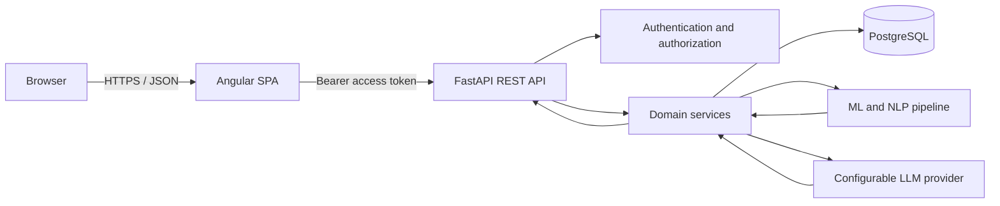
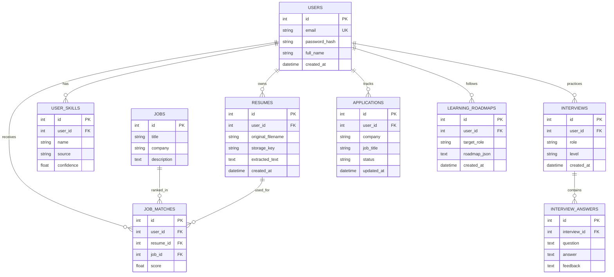

# CareerPilot AI system architecture

## System view



Angular is the presentation layer. FastAPI validates requests, authenticates callers, and delegates domain work to services. SQLAlchemy owns persistence; Alembic migrations evolve the schema. ML outputs (skill extraction and similarity scores), deterministic rules (workflow/status logic), and LLM-generated text must be labelled separately in API schemas and the interface. The LLM provider is isolated behind an adapter and is never required for core authentication or deterministic scoring.

## Repository layout

```text
careerpilot-ai/
├── docs/
│   ├── architecture.md
│   └── development.md
├── backend/
│   ├── app/
│   │   ├── api/routes/       # versioned REST endpoints
│   │   ├── core/             # settings, security, errors
│   │   ├── db/               # engine, session, base
│   │   ├── models/           # SQLAlchemy entities
│   │   ├── schemas/          # Pydantic request/response contracts
│   │   ├── services/         # domain logic
│   │   ├── ml/               # preprocessing, extraction, ranking, evaluation
│   │   ├── llm/              # provider adapters and prompt templates
│   │   └── main.py
│   ├── alembic/              # schema migrations (next setup increment)
│   ├── .env.example
│   └── requirements.txt
└── frontend/
    └── src/app/
        ├── core/             # auth, API, guards, interceptors
        ├── shared/           # reusable layout and UI components
        └── features/         # lazy-loadable product modules
```

The current implementation includes authentication plus the first dataset-backed resume review flow. Create remaining modules in their corresponding directories rather than putting business logic in route handlers or Angular components.

## Relational model



All entities should use UTC timestamps and indexed foreign keys. User-owned records must be scoped by authenticated `user_id`; never trust a user ID supplied by the browser. Resume files should ultimately live in private object storage, with only a storage key and extracted text in PostgreSQL. The first auth increment defines `users`; Alembic migrations and remaining tables are added with their modules.

## ML and LLM boundaries

- **Rule-based:** document validation, normalization, status transitions, and explicit skill dictionary matches. Report source and confidence where applicable.
- **Classical ML (implemented for the first resume flow):** TF-IDF plus logistic regression trained on O*NET 31.0 task statements predicts a broad occupation family. A separately built TF-IDF index compares resumes with 923 O*NET occupation profiles; this cosine score is similarity, not job-match probability. Macro precision, recall, and F1 are reported on a held-out task-statement split in `backend/app/ml/artifacts/training_metrics.json`.
- **Semantic ML:** optional Sentence Transformers embeddings, loaded lazily and cached; surface model name and score semantics.
- **LLM:** feedback, question generation, answer critique, cover letters, and roadmaps. Use provider adapters, structured Pydantic output validation, timeouts, bounded retries, and clear unavailable-provider errors. Treat uploaded resume/job content as untrusted data and keep secrets server-side.

Classification is not a meaningful feature until a suitable labelled dataset, its licence/provenance, split strategy, and precision/recall/F1 evaluation are documented. Do not fabricate a trained model or evaluation results.

## UI direction

Use a calm white canvas with deep navy navigation, a restrained blue accent, accessible contrast, and clear type hierarchy. Desktop uses a persistent sidebar and compact top bar; tablet collapses the sidebar; mobile uses a drawer and stacked cards. Keep upload and analysis states explicit (empty, processing, success, error). Dashboard cards summarize resume analyses, job matches, skill progress, practice, and applications. ECharts should have text summaries and accessible labels, not be the only presentation of key numbers. Prefer shared page headers, form fields, status chips, skeletons, and empty-state components. The starter implements a responsive sign-in/sign-up surface; the dashboard shell comes after auth is working.

## Delivery roadmap

1. **Foundation and auth (implemented):** app configuration, health endpoint, user table, password hashing, JWT, registration/login/current-profile endpoints, Angular auth screens and route guard.
2. **Dataset-backed resume review (implemented):** O*NET data, training/evaluation script and model artifact, PDF/DOCX text extraction, family prediction, role similarity, software-skill matching/gaps, Angular results page.
3. **Persistence hardening:** Alembic migrations, refresh-token strategy, account profile editing, and persisted resume-analysis history.
4. **Expanded job matching:** user-provided job descriptions, richer match explanations, optional semantic embeddings.
5. **Skill learning roadmaps:** personalized priority logic, roadmap generation and persisted progress.
6. **Interview coach:** provider adapter, question/answer flows, validated LLM outputs and history.
7. **Cover letters and applications:** editable generated content and tracker CRUD.
8. **Analytics and polish:** aggregated dashboard, ECharts, responsive/accessibility pass, loading/error/empty states.
9. **Release:** CI, full backend/frontend/database tests, migrations, deployment, README/API/ER docs, threat review.

Each module should be completed and checked before moving to the next. External LLM features require a server-side API key; the app should explain when a provider is not configured.
